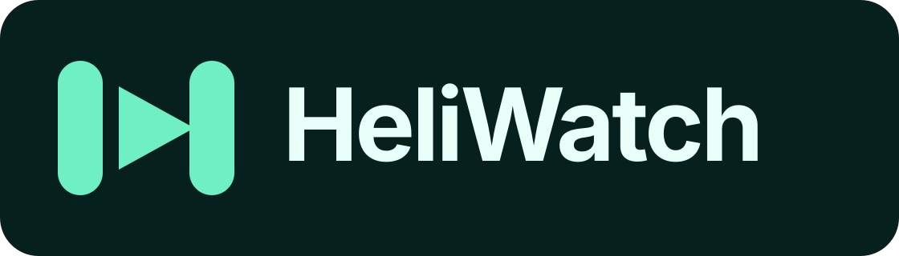

<p align="center">
  
</p>

<h1 align="center">HeliWatch</h1>

<p align="center">
  Смотрите видео вместе — сайт, файл или стрим — с голосом и чатом, без своих серверов.
</p>

<p align="center">
  
  
  
  
  
  
</p>

## Что это

HeliWatch — Android-приложение для совместного просмотра видео в реальном времени.
Один телефон открывает сайт или видеофайл, второй подключается по короткому коду —
и вы смотрите одно и то же: пауза, перемотка и скорость синхронны, а голос и чат
живут прямо поверх видео.

Своих серверов у проекта нет: соединение устанавливается напрямую между телефонами
(WebRTC), сигналинг идёт через публичные релеи, история и настройки хранятся только
на устройстве.

## Что уже работает в 0.1.0

Версия 0.1.0 — это каркас, на котором строятся следующие этапы. В APK уже есть:

- **Два WebView в одном окне.** Снизу — настоящий сайт (YouTube, тестовая страница),
  сверху — прозрачный React-интерфейс. Сайт скроллится и играет видео, панели
  HeliWatch рисуются поверх, не мешая странице.
- **Тач-роутинг.** React присылает прямоугольники своих панелей; касание внутри
  панели достаётся интерфейсу, всё остальное уходит в WebView сайта. Граница
  расширена на 6 dp, есть экран «Отладка → зоны касания».
- **Мост сайт ↔ приложение.** В страницу внедряется `site-hook.js`: он находит
  `<video>`, отдаёт время, длительность и состояние, а кнопки нижней панели
  («−10 с», play/pause, «+10 с») управляют видео на сайте.
- **Тестовая страница** с видео, кнопками, полями ввода, выбором файла и длинным
  списком для проверки скролла. Работает без сети, лежит внутри APK.
- **Тёмная тема и брендинг:** токены дизайна, логотип, адаптивная иконка Android.
- **Нативные заготовки:** системный выбор файла, fullscreen-видео, объявленные
  разрешения (микрофон, уведомления, foreground-сервис), освобождение куки и
  жизненный цикл WebView.
- **Инструменты:** `pnpm android:patch`, `pnpm android:doctor`, `pnpm version:set`,
  `pnpm icons`.

WebRTC, комнаты, голос, чат, PiP и фон появятся на этапах 2–7 — см. [PLAN.md](PLAN.md).

## Скриншоты

Пока приложение на этапе каркаса, файлы скриншотов ещё не сняты. Ниже — список,
который заполняется по мере готовности этапов: JPG, 1080×2340 (портрет) и
2340×1080 (ландшафт).

| Скриншот | Что на нём | Готовность |
|---|---|---|
| `01-lobby.jpg` | список открытых комнат | этап 6 |
| `02-room-site.jpg` | комната в режиме «Сайт»: сайт + оверлей | этап 2 |
| `03-room-file.jpg` | файл хоста, зритель смотрит стрим | этап 5 |
| `04-room-local.jpg` | один файл на двух телефонах | этап 2 |
| `05-chat-landscape.jpg` | чат-колонка в ландшафте | этап 3 |
| `06-chat-emoji.jpg` | эмодзи-панель и реакции | этап 3 |
| `07-photo-fullscreen.jpg` | фото в чате на весь экран | этап 3 |
| `08-dm.jpg` | личный чат с другом | этап 7 |
| `09-friends-profile.jpg` | друзья и профиль | этап 7 |
| `10-stats.jpg` | статистика просмотра | этап 7 |
| `11-settings.jpg` | настройки с динамическим акцентом | этап 7 |
| `12-pip.jpg` | PiP-окно | этап 4 |
| `13-accent.jpg` | кадр видео → акцентный цвет | этап 7 |
| `14-about.jpg` | экран «О приложении» | этап 7 |

Для 0.1.0 актуальны два временных кадра: тестовая страница с верхней и нижней
панелями HeliWatch и экран зон касания. Команда для будущих скриншотов —
`adb exec-out screencap -p > docs/screenshots/01-lobby.jpg`.

## Скачать

Готовые сборки лежат в [GitHub Releases](https://github.com/vezdehod2115/HeliWatch/releases).
Для 0.1.0 собирается debug APK `heliwatch-0.1.0-debug.apk` (arm64-v8a, ~31 МБ):

```powershell
adb install -r heliwatch-0.1.0-debug.apk
```

Локальная сборка после `pnpm android:apk` лежит в
`src-tauri/gen/android/app/build/outputs/apk/universal/debug/`; готовый файл
удобно скопировать в `release/heliwatch-0.1.0-debug.apk`.

Установка без ADB: скачайте APK на телефон и откройте файл; Android попросит
разрешить установку из этого источника. Debug-сборка ставится как отдельное
приложение (`dev.heliwatch.app.debug`), release-версия будет на этапе релиза.

## Как это работает

- **Сайт — в отдельном WebView.** HeliWatch не проксирует и не переписывает
  страницы: сайт получает обычный Chromium с куками и логинами, а React-слой
  общается с ним через мост и небольшой инжект.
- **Голос и видео — WebRTC P2P.** Своих серверов нет: STUN/TURN и публичные
  сигнальные релеи нужны только для установки соединения. Медиа и данные идут
  напрямую между устройствами.
- **Данные — только локально.** Профиль, история, друзья и настройки хранятся в
  SQLite на телефоне. Синхронизации между устройствами нет; бэкап — вручную
  файлом (этап 7).
- **Аккаунты не нужны.** Идентичность — ключ, созданный на устройстве; комната
  открывается по коду из 6 символов или ссылке `heliwatch://r/<code>`.

## Сборка из исходников

Нужно:

- Node.js ≥ 22.12 и pnpm 10;
- Rust 1.90+ (`rustup target add aarch64-linux-android armv7-linux-androideabi
  i686-linux-android x86_64-linux-android`);
- Android SDK 36 (platform + build-tools), NDK 27.x, JDK 17+;
- переменные окружения `ANDROID_HOME`, `NDK_HOME`, `JAVA_HOME`.

```powershell
pnpm install

# gen/android уже в репозитории; init нужен только для полной перегенерации:
pnpm tauri android init
pnpm android:patch
pnpm android:doctor

# разработка с живым Vite на подключённом телефоне
pnpm android:dev

# debug APK
pnpm android:apk
```

`pnpm android:apk` — это `tauri android build --apk --debug`; путь к APK печатает
CLI (обычно `src-tauri/gen/android/app/build/outputs/apk/universal/debug/`).
На Windows без включённого режима разработчика Tauri CLI не может создать
символьную ссылку на `.so` — обход через Gradle описан в
[docs/android-notes.md](docs/android-notes.md#windows-без-developer-mode).
Правки `gen/android` не теряются: их применяет идемпотентный
`scripts/apply-android-patches.mjs`, а `scripts/check-android.mjs` проверяет
маркеры. Подробности — [docs/android-notes.md](docs/android-notes.md).

Версия меняется одной командой:

```powershell
pnpm version:set 0.2.0
```

## Ограничения и известные проблемы

- **0.1.0 — каркас.** Нет комнат, синхронизации, голоса, чата, PiP и фонового
  сервиса. Это следующие этапы; приложение пока не годится для совместного
  просмотра.
- **Прозрачность двух WebView** зависит от прошивки. На части устройств возможны
  артефакты; по плану это проверяется на Android 11/13/15, а запасной вариант —
  split-режим без наложения (этап 1/4).
- **DRM и платные подписки** не обходятся. Сайт может не отдать защищённое видео
  в WebView, и это не ошибка HeliWatch.
- **Публичные релеи и TURN** не гарантируют доступность; на симметричном NAT
  может понадобиться свой TURN (появится в настройках на этапе 2/7).
- **История не синхронизируется** между устройствами и пропадёт без бэкапа.
- **Нет онлайн-статуса и push-уведомлений**: друга видно только при встрече в
  комнате (это осознанное ограничение без серверов).
- **Видео в iframe/shadow DOM** может не определяться инжектом; для этапа 1
  поддерживается `<video>` в основном документе.

## Стек

| Слой | Технология |
|---|---|
| Оболочка | Tauri v2.12, Rust 1.90+, Android Gradle 9 / Kotlin 2.2 |
| Интерфейс | React 19.3, TypeScript 5.9 (strict), Vite 8 (Rolldown), Tailwind CSS 4.3 |
| Нативный слой | Kotlin-плагин `heliwatch`: контейнер двух WebView, тач-роутер, `WebChromeClient`, мост событий |
| Связь (этапы 2+) | WebRTC, trystero 0.26 (pin), DataChannel |
| Данные (этап 2+) | SQLite через `@tauri-apps/plugin-sql`, миграции в Rust |
| Сборка | pnpm 10, Node.js 22.12+ |

## Лицензия

[MIT](LICENSE).

HeliWatch — независимый проект. Он не связан с YouTube, VK, Rutube и другими
сервисами, не обходит их ограничения и не претендует на их контент. Пользователь
сам отвечает за соблюдение правил сайтов, с которых смотрит видео.
